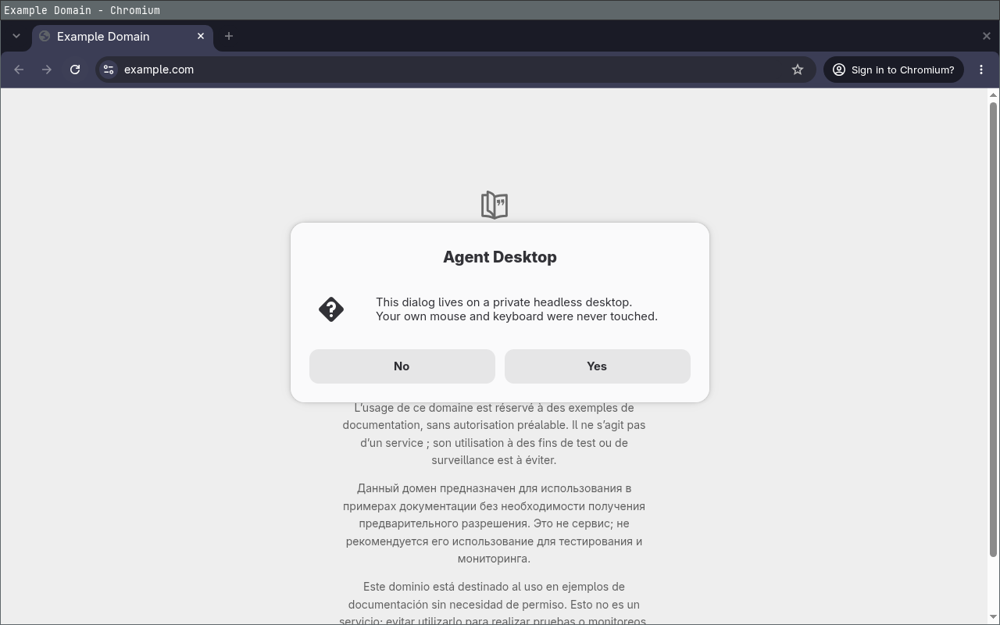

# Agent Desktop

**A private, headless Linux desktop for AI agents, so they can use GUI apps without touching your screen, mouse, or keyboard.**



Computer-use agents normally drive your real desktop: they steal focus, move your pointer, and type into whatever window happens to be in front. Agent Desktop gives the agent a desktop of its own instead. It starts a headless Sway compositor with Xwayland, a private D-Bus session, and a VNC bridge on a Unix socket. The agent launches apps there and sees and controls them through a small CLI or an MCP server, while you keep working on your own desktop.

- **Fully separate input and focus.** A separate compositor with its own virtual keyboard and pointer. Nothing reaches your Hyprland session.
- **Wayland and X11 apps.** Chromium, Electron, GTK4, Qt6, LibreOffice, terminals, wgpu apps.
- **MCP server included.** Works with Claude Code, Codex, or any MCP client. The desktop starts on first use.
- **Fast.** One persistent VNC connection, so most actions take 0.15–0.5 s including the screenshot that comes back.
- **No network listener.** VNC runs on a Unix socket in a mode-0700 runtime directory, so there is no TCP port and no password file.
- **Reliable text input.** Exact typing, including `$~"` and other shifted characters, plus åäö, €, CJK, and emoji.
- **Clean shutdown.** Windows are closed so apps can save, then every process the session started is ended, including ones that detached.

> [!NOTE]
> This is a prototype, built for [Omarchy](https://omarchy.org) (Arch + Hyprland) and tested on Omarchy 4 / Hyprland 0.56.2 on aarch64. Nothing in the core depends on Hyprland except the optional host-clipboard bridge and the bar widget, so it should run on most Linux desktops that can install Sway and WayVNC.

## Quick start

Install the two dependencies:

```sh
omarchy pkg add sway wayvnc wl-clipboard   # or: sudo pacman -S sway wayvnc wl-clipboard
```

Clone the repository and register the MCP server with your agent:

```sh
git clone https://github.com/jonatanferm/agent-desktop.git
claude mcp add agent-desktop -- "$PWD/agent-desktop/bin/agent-desktop-mcp"
codex mcp add agent-desktop -- "$PWD/agent-desktop/bin/agent-desktop-mcp"
```

Start a new agent session and ask it to do something in a GUI app. On Omarchy you can also install it as a plugin, which adds a start/stop button to the bar:

```sh
omarchy plugin add https://github.com/jonatanferm/agent-desktop --enable
```

## Uninstall

Stop the desktop, then remove whichever pieces you added:

```sh
bin/agent-desktop stop                                    # closes apps, ends all session processes
claude mcp remove agent-desktop                           # and/or: codex mcp remove agent-desktop
omarchy plugin remove io.github.jonatanferm.agent-desktop  # if installed as an Omarchy plugin
rm -rf ~/.local/share/agent-desktop                       # the agent's app profiles (browser data etc.)
```

Agent Desktop itself writes only to `~/.local/share/agent-desktop/`, to `$XDG_RUNTIME_DIR/agent-desktop/` (cleared on stop), and to screenshot paths you give it. It never modifies your own configuration.

To watch what the agent is doing, or to step in (for example at a CAPTCHA), bridge the VNC socket to localhost and connect a viewer:

```sh
socat TCP-LISTEN:5901,bind=127.0.0.1,reuseaddr,fork UNIX-CONNECT:$XDG_RUNTIME_DIR/agent-desktop/vnc.sock &
vncviewer localhost:5901
```

## MCP tools

| Tool | What it does |
| --- | --- |
| `computer_screenshot`, `computer_zoom` | Capture the screen, or a region of it scaled up |
| `computer_launch` | Start an app and wait until its window has settled |
| `computer_windows` | List, focus, close, fullscreen, or float windows |
| `computer_click`, `computer_double_click`, `computer_move`, `computer_drag`, `computer_scroll` | Pointer input, with optional modifiers |
| `computer_key`, `computer_type`, `computer_paste` | Key combos such as `ctrl+shift+t`, and exact text entry |
| `computer_wait` | Wait until the screen stops changing |
| `computer_actions` | Run up to 40 actions in one call |
| `computer_clipboard` | Read or write the private clipboard, or write the host clipboard |
| `computer_desktop` | Status, start, stop, and restart |

Input tools return a PNG screenshot and the focused window's title. `computer_actions` validates the whole batch before sending any input, and releases keys or buttons still held at the end. The server keeps its VNC connection open between calls and closes it after two idle minutes.

## CLI

Everything the MCP server does is also available from the shell, which is handy for scripts and for agents that are already running.

```sh
bin/agent-desktop start
bin/agent-desktop run -- chromium https://example.com     # waits for the window, prints its id
bin/agent-desktop run --cwd ~/code/app -- ./target/release/app
bin/agent-desktop windows                                   # list; also: focus|close|fullscreen|float <id>
bin/agent-desktop screenshot /tmp/shot.png
bin/agent-desktop screenshot /tmp/zoom.png --region 0,0,400,100 --scale 3
bin/agent-desktop click 200 150 --modifier ctrl
bin/agent-desktop triple-click 200 150
bin/agent-desktop key ctrl+shift+t
printf 'Hello, Göteborg\n' | bin/agent-desktop type
bin/agent-desktop scroll 640 400 3 --horizontal -2
bin/agent-desktop wait --timeout-ms 3000                    # until the screen stops changing
bin/agent-desktop actions '[{"type":"key","key":"ctrl+l"},{"type":"type","text":"example.com\n"}]'
printf 'clipboard text' | bin/agent-desktop clipboard private write
bin/agent-desktop status
bin/agent-desktop restart
bin/agent-desktop stop
```

Apps get the private desktop's Wayland, Xwayland, and D-Bus variables, so native Wayland and X11 programs both work. `run` reports the window that opened, after splash screens and first-run dialogs settle. New windows open as full-size tabs and dialogs float.

Apps use separate XDG config, data, and cache directories under `~/.local/share/agent-desktop/`, so the agent's browser profile is not yours. Files in your normal home directory are still available. App output goes to `$XDG_RUNTIME_DIR/agent-desktop/apps.log`.

## Configuration

| Variable | Effect |
| --- | --- |
| `AGENT_DESKTOP_RESOLUTION` | Output size at start, default `1280x800` |
| `AGENT_DESKTOP_ALLOW_HOST_CLIPBOARD=1` | Lets the agent read your real clipboard. It is off by default because the clipboard often holds passwords. Writing to it is always allowed. |
| `AGENT_DESKTOP_HOST_DISPLAY` | Hyprland Wayland socket for host clipboard access when several instances run |
| `AGENT_DESKTOP_RUNTIME`, `AGENT_DESKTOP_DATA` | Runtime and app-profile directories. Different values give a second, independent desktop. |
| `AGENT_DESKTOP_SWAY`, `AGENT_DESKTOP_WAYVNC` | Explicit binaries |
| `AGENT_DESKTOP_PACKAGES` | Extracted package tree used when Sway or WayVNC is not installed, default `~/.local/share/agent-desktop/runtime-packages/usr`. Its libraries are given only to Sway and WayVNC. |

Pass variables to the MCP server when you register it:

```sh
claude mcp add -e AGENT_DESKTOP_RESOLUTION=1440x900 agent-desktop -- /path/to/agent-desktop/bin/agent-desktop-mcp
```

## How it works

```
 agent ──MCP/stdio──▶ agent-desktop-mcp ─┐
 shell ─────────────▶ agent-desktop ─────┤   (the MCP server imports the CLI)
                                         │
              ┌──────────────────────────┴──────────────────────────┐
              ▼                                                     ▼
   vnc.sock (WayVNC, Unix socket,                     Sway IPC socket
   in a mode-0700 runtime dir)                        launch, list, focus, close
   screenshots, virtual keyboard + pointer            windows
              │                                                     │
              └──────────────▶ headless Sway + Xwayland ◀───────────┘
                               + private D-Bus session
                                         │
                       Chromium · LibreOffice · GTK · Qt · Electron …
```

### Input

WayVNC provides a virtual keyboard with a US keymap and turns each VNC keysym into a key press at some level. Keys are therefore sent the way a physical US keyboard would send them: Shift is pressed explicitly for shifted characters, and `shift+4` is sent as Shift + `$`. Without this, Chromium drops characters such as `$`, and `shift+v` combos lose their Shift.

Text outside the US keymap (åäö, €, CJK, emoji) is pasted a line at a time through the private clipboard, with Ctrl+Shift+V in terminals and Ctrl+V elsewhere. Typed newlines still press Enter. This replaces the private clipboard's contents. A second virtual keyboard (`wtype`) was tried, but X11 apps read its keys with a stale keymap, and Chromium drops the first key after each keymap switch.

After Ctrl, Alt, or Super shortcuts the CLI waits 100 ms, because apps such as LibreOffice run shortcuts asynchronously and would otherwise apply them after the next typed key. The host's input-method variables (fcitx, IBus) are removed from the desktop's environment, since no input method runs there.

### Why Sway and WayVNC

| Option | GUI coverage | Focus isolation | Main limitation |
| --- | --- | --- | --- |
| Hidden Hyprland workspace or output | Wayland and X11 | Shared compositor focus | Input and workspace changes can reach the physical session |
| Xvfb | X11 | Separate display | Native Wayland apps need a fallback or another compositor |
| Weston headless + VNC | Wayland and X11 | Separate compositor | Weston VNC uses system PAM configuration |
| **Sway headless + WayVNC** | **Wayland and X11** | **Separate compositor** | **Two packages and a small control bridge** |
| VM or separate Linux user | Broadest isolation | Separate user or OS session | More setup and resource cost |

Sway and WayVNC give a separate compositor with virtual input, and once the packages are installed everything else stays per-user. WayVNC's Unix socket avoids both a network listener and a VNC password file.

## Limitations

> [!WARNING]
> This isolates **display, input focus, app profiles, and the session bus**. It is not a security sandbox. Apps run as your Linux user and can read and write the same files. An app that deliberately connects to your Hyprland socket can still control it. If you need real isolation, use a VM or a separate user.

- Rendering is software-only (pixman). Vulkan apps fall back to software OpenGL where they support it, as wgpu does.
- Apps that need a specific GPU, screen-sharing portals, audio, a tray, or login integration may need extra work.
- Some apps have their own single-instance rules. The separate XDG directories and D-Bus bus cover the common cases, but not every app.
- WayVNC captures frames only while a client is connected and answers a new connection with its last frame, so the CLI waits 150 ms after connecting before its first screenshot.
- Screenshots are PNG without the pointer. The resolution is fixed while the desktop runs. The clipboard tools handle plain text only.

Verified apps: foot, Chromium (Wayland and X11), Zenity and Nautilus (GTK4), LibreOffice Writer, cmake-gui (Qt6), Obsidian (Electron), and an eframe/wgpu app.

## Development

```sh
python -m py_compile bin/agent-desktop bin/agent-desktop-mcp
python tests/smoke.py        # runs against a separate, temporary desktop
omarchy plugin validate .
```

`tests/smoke.py` starts its own temporary desktop, so it leaves a running one alone. It checks typing byte-for-byte through a terminal; pointer and key events through a Chromium page that reports what it receives; and the clipboard, window control, batch validation, and process cleanup. Missing apps are skipped.

Beyond Sway, WayVNC, and wl-clipboard, the project needs only the Python standard library. The Python CLI owns the compositor and the VNC bridge. The Omarchy plugin is deliberately thin: `BarWidget.qml` only offers a start/stop button.

## License

[BSD Zero Clause (0BSD)](LICENSE): use it for anything, no attribution required.
